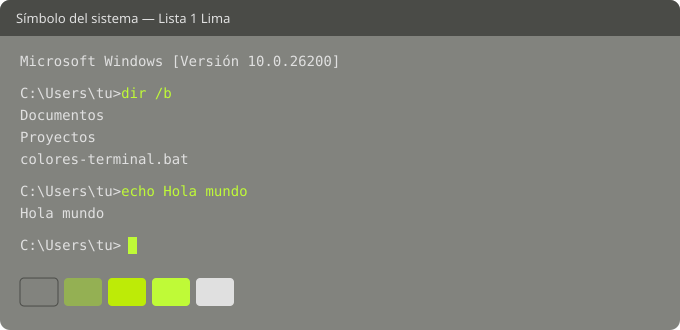
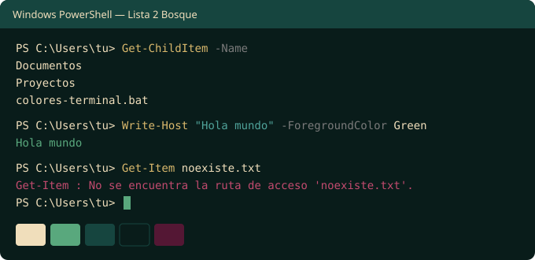

# Colores de terminal

Dos esquemas de color para **Windows Terminal**, listos para instalar con un doble clic:

- **Símbolo del sistema (CMD)** → *Lista 1 Lima*
- **Windows PowerShell** → *Lista 2 Bosque*

## Vista previa

### Lista 1 Lima — CMD



| Color | Uso |
|---|---|
| `#82837E` | Fondo |
| `#94B053` | Selección, verde |
| `#BDEB07` | Amarillo |
| `#BFFA37` | Cursor, verde brillante |
| `#E0E0E0` | Texto |

### Lista 2 Bosque — PowerShell



| Color | Uso |
|---|---|
| `#F0DEBB` | Texto |
| `#59A87D` | Cursor, verde |
| `#16453F` | Selección, negro brillante |
| `#091C1A` | Fondo |
| `#541734` | Base de los tonos rojo y magenta |

> Cada paleta tiene 5 colores y una terminal usa 16, así que los colores restantes (rojo, azul, morado, etc.) son tonos derivados para que los errores y resaltados sigan viéndose.

## Instalación

1. Instala [Windows Terminal](https://aka.ms/terminal) y ábrelo al menos una vez.
2. Descarga [`colores-terminal.bat`](colores-terminal.bat).
3. Haz doble clic en el archivo.
4. Abre una pestaña nueva de CMD o PowerShell en Windows Terminal.

Si Windows muestra un aviso de SmartScreen al abrir el archivo, elige **Más información → Ejecutar de todas formas**. Es normal en archivos `.bat` descargados de internet; puedes revisar el contenido del archivo antes de ejecutarlo.

## Qué hace el script

- Busca el `settings.json` de Windows Terminal (versión de la Microsoft Store, Preview o instalación sin Store).
- Guarda una copia de seguridad como `settings.json.bak` en la misma carpeta.
- Agrega los esquemas *Lista 1 Lima* y *Lista 2 Bosque*. Si ya existen, los reemplaza, así que puedes ejecutarlo varias veces.
- Asigna cada esquema a su perfil (CMD y Windows PowerShell).
- Si algo falla, no modifica la configuración.

**Nota:** al guardar, el script elimina los comentarios (`// ...`) y reordena el formato de `settings.json`. Tus ajustes no cambian.

## Desinstalar

Restaura la copia de seguridad. En PowerShell:

```powershell
$dir = "$env:LOCALAPPDATA\Packages\Microsoft.WindowsTerminal_8wekyb3d8bbwe\LocalState"
Copy-Item "$dir\settings.json.bak" "$dir\settings.json" -Force
```

O bien, en Windows Terminal ve a **Configuración → perfil → Apariencia → Combinación de colores** y elige otra.

## Instalación manual

Si prefieres no ejecutar el script, abre la configuración de Windows Terminal (`Ctrl + Shift + ,`) y pega esto en `"schemes"`:

```json
{
    "name": "Lista 1 Lima",
    "background": "#82837E", "foreground": "#E0E0E0",
    "cursorColor": "#BFFA37", "selectionBackground": "#94B053",
    "black": "#4A4B47", "red": "#E06C5A", "green": "#94B053", "yellow": "#BDEB07",
    "blue": "#6E8FA8", "purple": "#A88BB0", "cyan": "#7FC8B0", "white": "#E0E0E0",
    "brightBlack": "#5E5F5A", "brightRed": "#FF8A75", "brightGreen": "#BFFA37", "brightYellow": "#DFFF5A",
    "brightBlue": "#8FB0C8", "brightPurple": "#C8A8D0", "brightCyan": "#A0E8D0", "brightWhite": "#FFFFFF"
},
{
    "name": "Lista 2 Bosque",
    "background": "#091C1A", "foreground": "#F0DEBB",
    "cursorColor": "#59A87D", "selectionBackground": "#16453F",
    "black": "#091C1A", "red": "#8E2A50", "green": "#59A87D", "yellow": "#D9B86C",
    "blue": "#3E8A80", "purple": "#7A2E4D", "cyan": "#4FA39A", "white": "#F0DEBB",
    "brightBlack": "#16453F", "brightRed": "#C24A6E", "brightGreen": "#7FCB9F", "brightYellow": "#F5E6C8",
    "brightBlue": "#5FB0A5", "brightPurple": "#A04670", "brightCyan": "#7FD0C4", "brightWhite": "#FFF6E3"
}
```

Luego, en cada perfil, agrega `"colorScheme": "Lista 1 Lima"` (CMD) o `"colorScheme": "Lista 2 Bosque"` (PowerShell).
